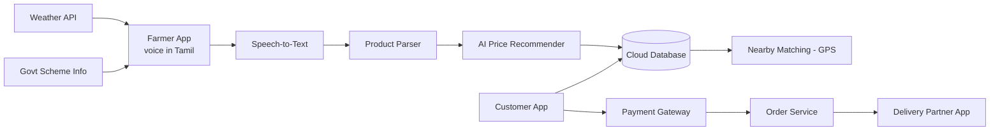

# Architecture – FarmDirect 360 AI

## System diagram

## Modules
| Module | Prototype status | Production plan |
|---|---|---|
| Voice listing (Tamil) | Working (Web Speech API, ta-IN) | Cloud speech-to-text, more languages |
| Price recommendation | Rule-based demo | ML model on mandi price data |
| Marketplace + cart | Working | Firebase / PostgreSQL |
| Payment | Simulated | Razorpay / UPI |
| Order tracking | Working (3 stages) | Live GPS tracking |
| Delivery partner | Working | Route optimisation |
| Weather alert | Static demo | Weather API |
| Image detection | Not in prototype | CNN / MobileNet |

## Data flow
1. Farmer speaks -> text -> `parse()` extracts product, quantity, price.
2. `recommend()` suggests a fair price range from market reference.
3. Product is listed; customers see it in the marketplace.
4. Customer pays; `placeOrder()` reduces stock and creates an order.
5. Delivery partner picks up (stage 2) and delivers (stage 3).

## SDG alignment
SDG 8 (decent work), SDG 9 (innovation), SDG 12 (responsible consumption).
